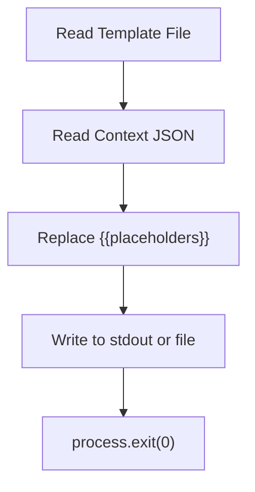

# AI Prompt Orchestrator CLI
**Advanced AI Prompt Orchestrator & Local Context Tool**


## Overview
Developers often juggle prompt templates and dynamic context data when working with generative AI models. Switching between editors, manually copying snippets, and ensuring placeholders are correctly populated introduces friction and errors. **AI Prompt Orchestrator CLI** bridges that gap by letting you compose, inject, and export prompts directly from the terminal, keeping your workflow fast and reproducible.

## Installation & Quick Start
```bash
git clone https://github.com/yourname/ai-prompt-orchestrator-cli.git
cd ai-prompt-orchestrator-cli
node src/index.js -h
```

### Example Usage
```bash
# Create a template file
cat > prompt.txt <<'EOF'
Write a story about {{character}} who lives in {{setting}}.
EOF

# Create a context JSON file
cat > ctx.json <<'EOF'
{
  "character": "Ada Lovelace",
  "setting": "a steampunk London"
}
EOF

# Generate the final prompt
node src/index.js -t prompt.txt -c ctx.json
```

## Architecture


## Test Results
## 🧪 Real-World Test Telemetry

> [!NOTE]
> Verified automatically using Node.js native test runner (`node:test` & `node:assert/strict`).

```bash
▶ node --test
TAP version 13
# Subtest: CLI replaces placeholders with context values
ok 1 - CLI replaces placeholders with context values
  ---
  duration_ms: 26.614561
  ...
1..1
# tests 1
# suites 0
# pass 1
# fail 0
# cancelled 0
# skipped 0
# todo 0
# duration_ms 60.972723
```

## Contributing
Feel free to open issues or submit pull requests. All contributions are welcome.

## License
MIT © 2026 Suman Mehta